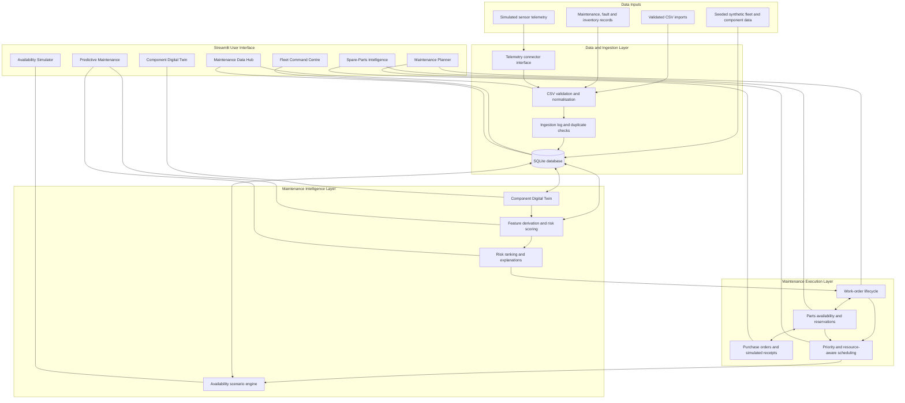
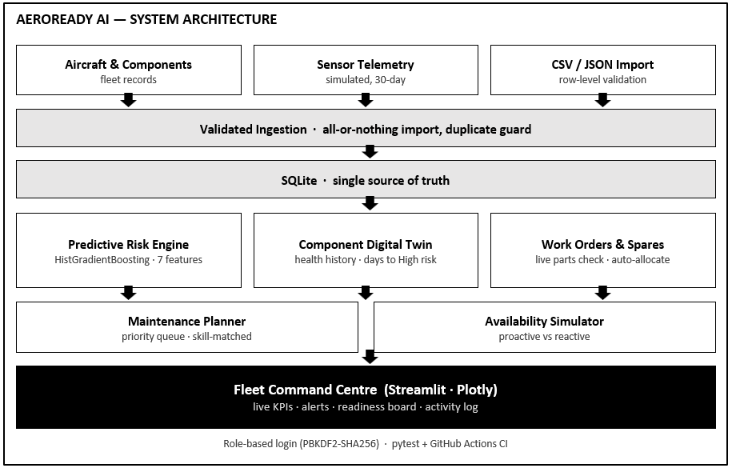

# AeroReady AI — Predictive Maintenance & Fleet Availability

<p align="center">
  <strong>SIH 2026 · Problem Statement SIH26249</strong><br>
  <em>From component-health signals to maintenance action and fleet-readiness insight.</em>
</p>

<p align="center">
  <a href="https://aeroready.streamlit.app"><strong>🚀 Open Live Demo</strong></a>
</p>

<p align="center">
  <a href="https://aeroready.streamlit.app"></a>
  
  
  
  
</p>

> **Important scope note:** AeroReady AI is a decision-support prototype. Aircraft, components, teams, maintenance records, part numbers and sensor readings are fictional/synthetic. The risk model has been evaluated on synthetic data only. Outputs are not validated for real-world airworthiness, operational deployment, or maintenance decisions.

---

## Table of Contents

1. [IDEA](#1-idea)
2. [Problem Statement and Motivation](#2-problem-statement-and-motivation)
3. [Proposed Solution](#3-proposed-solution)
4. [System Block Diagram](#4-system-block-diagram)
5. [Technical Approach](#5-technical-approach)
6. [Application Modules](#6-application-modules)
7. [End-to-End Demonstration Workflow](#7-end-to-end-demonstration-workflow)
8. [Technology Stack](#8-technology-stack)
9. [FEASIBILITY AND VIABILITY](#9-feasibility-and-viability)
10. [IMPACT AND BENEFITS](#10-impact-and-benefits)
11. [Limitations, Assumptions, and Safety Boundaries](#11-limitations-assumptions-and-safety-boundaries)
12. [Roadmap](#12-roadmap)
13. [Run Locally](#13-run-locally)
14. [Demo Access](#14-demo-access)
15. [Research and References](#15-research-and-references)
16. [Project Structure](#16-project-structure)

---

## 1. IDEA

**AeroReady AI is an integrated predictive-maintenance and fleet-availability decision-support platform.** It connects component-health monitoring, maintenance-risk prioritisation, work-order management, spare-parts coordination, maintenance scheduling, and scenario simulation in one application.

The central idea is to connect the steps that are often considered separately:

**Component data → Health/risk assessment → Maintenance work order → Parts and people → Schedule → Fleet-availability scenario**

Instead of stopping at an alert or a risk score, the prototype lets a user explore what happens operationally after a component is flagged for attention. A user can change simulated sensor readings, inspect the component-level assessment, raise a work order, experience a spare-parts constraint, receive a simulated delivery, schedule the job, and compare fleet-level scenarios.

### Live prototype

**[Launch AeroReady AI](https://aeroready.streamlit.app)**

The live application is intended for exploration and demonstration using fictional data. It should not be used to make real aircraft maintenance or airworthiness decisions.

## 2. Problem Statement and Motivation

Fleet readiness can be affected by several connected operational challenges:

- **Unexpected component degradation:** changes in temperature, vibration, pressure, utilisation, or fault history may indicate that a component needs review.
- **Reactive maintenance:** identifying a potential issue is only useful if the organisation can prioritise and act on it in time.
- **Parts-driven delays:** a maintenance task may be delayed if the required spare is unavailable or reserved for another task.
- **Scheduling conflicts:** teams have limited capacity and different skill sets; maintenance work must be sequenced around these constraints.
- **Limited decision visibility:** maintenance managers need to understand how parts, workload, and maintenance timing may affect fleet availability.

AeroReady AI demonstrates a single workflow that links these factors. It is designed to support human decision-making, not replace authorised engineering judgement or approved maintenance procedures.

## 3. Proposed Solution

The application provides seven connected operational modules:

1. **Fleet Command Centre** — fleet serviceability, availability, maintenance backlog, alerts, risk trends, and activity overview.
2. **Maintenance Data Hub** — searchable operational records, validated CSV import/export, ingestion status, and a simulated telemetry connector.
3. **Predictive Maintenance** — component risk ranking, risk explanations, recommended review actions, and what-if analysis.
4. **Component Digital Twin** — component profile, sensor history, simulated sensor controls, health trends, and illustrative degradation projection.
5. **Maintenance Planner** — priority queue, parts-aware scheduling, team-skill checks, schedule visualisation, and work-order lifecycle actions.
6. **Spare-Parts Intelligence** — stock and reservations, shortage visibility, reorder suggestions, purchase orders, and simulated delivery receipt.
7. **Availability Simulator** — comparison of proactive/reactive maintenance assumptions and resource scenarios, with projected availability curves and aircraft downtime timelines.

The key differentiator in the prototype is **workflow integration**: a risk assessment can lead to a work order; the work order checks parts; parts status affects scheduling; and the simulator helps explore the consequences of different planning assumptions.

## 4. System Block Diagram

The diagram below describes the prototype's logical architecture. It distinguishes incoming data, application logic, operational workflows, and user-facing outputs.



### System Architecture



### Architecture summary

- **Presentation:** Streamlit application and seven operational views.
- **Application logic:** Python modules for risk scoring, component state, work orders, inventory, scheduling, ingestion, and availability scenarios.
- **Persistence:** SQLite database with application-managed schema and demo data.
- **Input paths:** seeded synthetic data, validated CSV uploads, and a simulated JSON/API-style telemetry connector.
- **Outputs:** dashboards, risk explanations, work-order states, inventory status, suggested schedules, and scenario comparisons.

**Integration boundary:** the current connector is simulated. No real aircraft, defence, maintenance-management, or IoT system is connected.

## 5. Technical Approach

### 5.1 Data preparation and ingestion

The prototype starts with a reproducible synthetic fleet dataset and supports selected CSV imports for maintenance-related records. Imported data is validated before persistence, with row-level feedback for invalid data. Source identifiers and duplicate checks help prevent repeated readings from being stored more than once. Ingestion outcomes are logged for traceability.

A connector interface demonstrates how a future source could fetch and normalise telemetry. The included source is a **simulation**, not a live aircraft feed.

### 5.2 Component health and risk scoring

The risk pipeline derives features such as:

- Operating hours relative to rated life
- Hours since last maintenance
- Component age
- Temperature deviation
- Vibration
- Pressure deviation
- Previous fault history

The project includes a `HistGradientBoostingClassifier` candidate trained on generated synthetic examples, alongside a transparent rule-based risk score. The evaluation design separates training, validation, and test data; the selected method is based on validation ROC-AUC, and the model card reports test metrics for both approaches.

On the current synthetic dataset, the model and rule-based method perform similarly, so the application selects the transparent rule-based method rather than claiming an ML advantage that the evaluation does not demonstrate.

**Interpretation:** the displayed score is a prototype maintenance-risk index, not a calibrated probability of component failure. A score of 70 does **not** mean a 70% chance of failure. Explanations compare a component's features with a healthy reference profile; they do not establish causality.

### 5.3 Component Digital Twin

The Digital Twin is a **software simulation** of a component's state, readings, usage, and maintenance history. Users can change simulated operating parameters and observe the effect on the calculated score. Trend projections are illustrative linear extrapolations and require sufficient readings; they are not validated remaining-useful-life estimates or physics-based models.

### 5.4 Work orders and inventory logic

Work orders connect risk review with maintenance execution. The workflow checks whether the required part is available and reserves stock where possible. If a part is unavailable, a job can enter **Awaiting Parts**. Simulated purchase-order receipt updates inventory and can allocate stock to waiting work orders according to priority. Completing or cancelling a job updates the relevant workflow and stock state.

### 5.5 Maintenance scheduling

The planner uses a transparent priority-based greedy heuristic. It considers job urgency, parts readiness, team skills, and team overlap, and proposes assignments intended to avoid double-booking a team. It is a suggested schedule, not a globally optimal schedule or a full aviation maintenance resource-planning solver.

### 5.6 Fleet availability simulation

The simulator compares scenarios under explicit assumptions, including proactive versus reactive maintenance and resource changes such as expediting parts or adding team capacity. It displays projected availability and downtime across a selected horizon.

These are **what-if scenario results**, not forecasts of real-world fleet performance. Reactive-event timings and resource assumptions are scenario inputs rather than validated model predictions.

## 6. Application Modules

| Module | Main responsibility | What a reviewer can try |
|---|---|---|
| Fleet Command Centre | Consolidated fleet-readiness view, serviceability, alerts, maintenance backlog, trends, and activity | Review the fleet board and inspect high-risk or unavailable aircraft. |
| Maintenance Data Hub | Search/filter records, CSV export, validated CSV import, and ingestion traceability | Inspect records or test an example import and its validation feedback. |
| Predictive Maintenance | Risk ranking, per-component explanation, recommendations, what-if analysis, and model card | Compare a component's risk and inspect the explanation/model evaluation. |
| Component Digital Twin | Component profile, simulated readings, sensor trends, maintenance history, and state | Change vibration/temperature/pressure and commit a simulated reading. |
| Maintenance Planner | Priority queue, parts-aware suggested schedule, Gantt chart, team-skill and overlap checks | Generate/apply a schedule, then start or complete a work order. |
| Spare-Parts Intelligence | Stock, reservations, shortages, reorder suggestions, purchase orders, simulated deliveries | Receive a simulated delivery and see how waiting work orders are affected. |
| Availability Simulator | Scenario comparisons, projected availability curves, downtime timelines, assumptions | Compare proactive/reactive strategies or change a resource assumption. |

## 7. End-to-End Demonstration Workflow

For the clearest demonstration, follow this sequence:

1. **Inspect fleet readiness** in the Fleet Command Centre.
2. **Select an aircraft/component** and open its Digital Twin.
3. **Change simulated sensor values** and observe the risk assessment.
4. **Review the risk explanation** in Predictive Maintenance.
5. **Create a maintenance work order** and check the part requirement.
6. **Open Spare-Parts Intelligence** and inspect a shortage or reservation.
7. **Place a simulated purchase order and receive the part**, then verify the work-order state.
8. **Generate a maintenance schedule** and inspect team assignments and the Gantt chart.
9. **Complete the work order** using the workflow controls.
10. **Compare availability scenarios** in the Availability Simulator and return to the dashboard.

This walkthrough demonstrates the connection between component assessment and operational planning rather than presenting each module as an isolated screen.

## 8. Technology Stack

| Layer | Technology | Role in the prototype |
|---|---|---|
| User interface | Streamlit | Interactive web application and module navigation |
| Language | Python | Application and business logic |
| Data handling | pandas, NumPy | Tabular data processing and numerical operations |
| Machine learning | scikit-learn | Synthetic-data model training, evaluation, and candidate scoring |
| Visualisation | Plotly | Interactive charts and scheduling/scenario views |
| Database | SQLite | Local persistence for application records and demo workflow |
| Data exchange | CSV and simulated JSON connector | Import/export and telemetry-ingestion demonstration |
| Testing | pytest | Automated tests for model, ingestion, workflow, scheduling, and scenarios |
| CI | GitHub Actions | Runs the test suite on pushes and pull requests |
| Hosting | Streamlit Community Cloud | Public demo hosting |

## 9. FEASIBILITY AND VIABILITY

### Technical feasibility

- **Prototype is executable today:** it is a Python/Streamlit application with a documented local run command and a hosted demonstration.
- **Modular design:** UI views are separated from domain logic for data ingestion, risk scoring, work orders, inventory, planning, and simulation.
- **Low infrastructure requirements:** the current demonstration uses SQLite and synthetic data; it does not require aircraft hardware, a GPU, external APIs, or paid datasets.
- **Testability:** the repository includes automated tests covering key workflows and business rules, plus a CI workflow.
- **Extensible integration pattern:** CSV ingestion and a connector interface provide a starting point for approved data integrations after interface, security, and data-quality requirements are defined.

### Operational feasibility

The UI is organised around familiar maintenance activities: identify a risk, inspect the component, raise work, verify parts, schedule resources, and assess potential fleet-level impact. The workflow is suitable for demonstrating how maintenance planners and fleet coordinators could collaborate around a common operational picture.

Real operational adoption would require user research, alignment with approved maintenance processes, role and access design, training, data governance, and human-factors review.

### Economic and deployment viability

A pilot could begin with a read-only or offline analysis of authorised historical records, avoiding immediate integration with safety-critical systems. The prototype's open-source Python stack can reduce initial software licensing costs, although secure hosting, integration, validation, support, and operational assurance would still require resources.

A sensible staged path is:

1. Validate the concept using synthetic data and stakeholder feedback.
2. Run retrospective experiments on authorised, de-identified historical data.
3. Pilot as a non-authoritative decision-support tool with maintenance experts.
4. Integrate approved data sources and operational controls only after security and validation reviews.
5. Expand gradually based on measured value, user acceptance, and governance approval.

### Key feasibility risks and mitigations

| Risk | Why it matters | Mitigation / next step |
|---|---|---|
| Synthetic training data | Metrics may not transfer to real components | Validate on representative, labelled historical data and independent holdout sets. |
| Simulated telemetry | Does not prove real-system integration | Define approved interfaces, units, timestamps, data quality, and access controls. |
| SQLite persistence | Local filesystem persistence may not suit multi-user production | Move to managed database infrastructure for a real pilot. |
| Simplified scheduler | Does not model every real-world constraint | Add shifts, tooling, hangar capacity, certifications, multi-part kits, and solver-based optimisation as requirements emerge. |
| Operational safety | A score must not determine serviceability | Keep authorised personnel and approved maintenance procedures in control. |
| Security and identity | Demo accounts are not enterprise identity management | Implement enterprise authentication, least privilege, secrets management, audit, and security testing. |

## 10. IMPACT AND BENEFITS

AeroReady AI's potential value is in improving **visibility, coordination, and decision quality** across the maintenance workflow. The prototype does not yet establish quantified real-world savings or readiness gains.

### Potential benefits

- **Earlier attention to component risk:** brings risk-ranked components and explanatory features into one view for review.
- **Connected maintenance workflow:** reduces the gap between identifying a potential issue and creating a work order.
- **Parts-aware planning:** makes stock constraints visible before work is scheduled and demonstrates how simulated receipts can unblock jobs.
- **Resource coordination:** highlights team conflicts and produces a suggested schedule around basic constraints.
- **Scenario comparison:** helps users examine how alternative maintenance and resource assumptions could change projected downtime.
- **Traceability:** stores records and ingestion outcomes to support inspection of the demonstration workflow.
- **Reusable foundation:** offers a modular starting point for future evaluation with authorised data and stakeholder input.

### How impact should be measured in a real pilot

| Objective | Example evaluation measure | Required evidence |
|---|---|---|
| Predictive usefulness | Precision/recall at operationally relevant thresholds; PR-AUC/ROC-AUC; calibration | Labelled historical data and a leakage-controlled evaluation design |
| Maintenance responsiveness | Time from alert to review/work order | Timestamped records and a comparable baseline |
| Parts availability | Stockout frequency, waiting-for-parts duration, inventory turns | Reliable inventory and purchase-order history |
| Planning quality | Schedule conflicts, rescheduling frequency, plan adherence | Real resource calendars and completed work records |
| Fleet readiness | Availability and unavailable aircraft-days under consistent definitions | Authoritative fleet status data and a fair comparison period |
| User value | Planner task time, usability, adoption, and override rates | Structured pilot evaluation and user feedback |

Any future claims of downtime reduction, cost savings, or improved availability should be reported only after a measured pilot with a defined baseline and transparent assumptions.

## 11. Limitations, Assumptions, and Safety Boundaries

AeroReady AI is a demonstration prototype, not a certified aviation maintenance system.

- All fleet, component, maintenance, team, inventory, and sensor data in the demonstration is fictional or synthetic.
- Model evaluation reflects patterns in the synthetic data generator, not proven real-world predictive performance.
- The prototype risk score is not a calibrated probability of failure.
- Feature explanations show changes relative to a reference profile and do not prove that a feature caused a risk.
- The Digital Twin is a software simulation, not a physics-based aircraft model.
- Degradation projections are illustrative trend extrapolations, not validated remaining-useful-life estimates.
- Scheduling is a greedy heuristic and omits several real-world constraints, including shift patterns, hangar slots, tooling, and multi-part kits.
- Availability outputs are scenario comparisons under stated assumptions, not operational forecasts.
- The included telemetry connector is simulated; there is no live aircraft or defence-system integration.
- Demo authentication and SQLite are not suitable substitutes for production identity, security, availability, or database architecture.
- The application must not be used to authorise maintenance, determine airworthiness, or ground/release an aircraft.

## 12. Roadmap

### Phase 1 — Prototype hardening

- Improve deployment reliability, error handling, and observability.
- Add demo reset guidance and more visible scenario assumptions.
- Continue regression tests for ingestion, workflow transitions, inventory invariants, and scheduling constraints.

### Phase 2 — Data and model validation

- Obtain authorised, de-identified, representative maintenance data.
- Establish target definitions, missing-data handling, temporal and component-level split strategy, and leakage checks.
- Compare the rule-based baseline with candidate models using appropriate discrimination and calibration metrics.
- Conduct independent review with domain experts before presenting scores as operationally meaningful.

### Phase 3 — Planning and integration

- Evaluate optimisation methods for richer scheduling constraints.
- Add approved interfaces for maintenance and inventory systems in a sandbox environment.
- Introduce stronger authentication, role management, audit controls, secrets management, and a managed database.

### Phase 4 — Controlled pilot

- Run in shadow mode with authorised users and no automatic maintenance decisions.
- Measure outcomes against a documented baseline.
- Review safety, cybersecurity, data governance, usability, and operational acceptance before considering wider use.

## 13. Run Locally

### Prerequisites

- A supported Python version compatible with `requirements.txt`
- Git (optional, for cloning the repository)

### Installation

```bash
# Create and activate a virtual environment
python -m venv .venv

# Windows PowerShell
.\.venv\Scripts\Activate.ps1

# macOS/Linux
source .venv/bin/activate

# Install dependencies
python -m pip install --upgrade pip
python -m pip install -r requirements.txt

# Start the application from the project root
python -m streamlit run app.py
```

Streamlit will print a local URL, typically `http://localhost:8501`.

### Demo accounts

| Username | Password | Role |
|---|---|---|
| `admin` | `admin@123` | Demo administrator; includes demo reset access |
| `planner` | `planner@123` | Maintenance planner; operational access without demo reset |

These are public demonstration credentials, not secure production accounts. Do not reuse these passwords or put real operational data into the public demo.

### Run automated tests

```bash
python -m pytest -q
```

The repository includes tests for authentication, risk scoring, ingestion, digital-twin behaviour, work-order workflows, inventory, scheduling, availability scenarios, CSV handling, and safety wording. GitHub Actions is configured to run tests on pushes and pull requests.

### Data location and reset

On first launch, the application creates its synthetic demonstration data and database under `data/`. The app's reset function can restore demo data. To use a different data directory, set `AEROREADY_DATA_DIR` before launching. On hosted environments, local database persistence should be treated as temporary; do not rely on it as a production database.

## 14. Demo Access

- **Live application:** [https://aeroready.streamlit.app](https://aeroready.streamlit.app)
- **Platform:** Streamlit Community Cloud
- **Data mode:** Synthetic/demo data
- **Suggested walkthrough:** follow [End-to-End Demonstration Workflow](#7-end-to-end-demonstration-workflow)

If the app is sleeping or starting, allow it time to initialise. The first launch may take longer while the environment and synthetic dataset are prepared.

## 15. Research and References

The following references provide background for the prototype's technical approach and responsible development. They are not evidence that AeroReady AI has been validated for real aircraft operations, and the prototype does not claim to use the referenced organisations' data unless explicitly stated.

1. **Streamlit Community Cloud — Deploy your app.** Official documentation for deploying a Streamlit application from a GitHub repository. [https://docs.streamlit.io/deploy/streamlit-community-cloud/deploy-your-app/deploy](https://docs.streamlit.io/deploy/streamlit-community-cloud/deploy-your-app/deploy)
2. **Streamlit Community Cloud — File organization.** Official guidance on application entry points, dependencies, configuration, and repository layout. [https://docs.streamlit.io/deploy/streamlit-community-cloud/deploy-your-app/file-organization](https://docs.streamlit.io/deploy/streamlit-community-cloud/deploy-your-app/file-organization)
3. **NASA Ames Prognostics Center of Excellence — Prognostics Data Repository.** Public research datasets and background relevant to prognostics and health management research. AeroReady AI's current demo does **not** use these datasets; it uses synthetic data. [https://ti.arc.nasa.gov/tech/dash/groups/pcoe/prognostic-data-repository/](https://ti.arc.nasa.gov/tech/dash/groups/pcoe/prognostic-data-repository/)
4. **NIST — AI Risk Management Framework.** Guidance for identifying and managing AI-related risks across design, development, deployment, and use. [https://www.nist.gov/itl/ai-risk-management-framework](https://www.nist.gov/itl/ai-risk-management-framework)
5. **scikit-learn — HistGradientBoostingClassifier documentation.** Reference for the gradient-boosting classifier available in the scikit-learn library. [https://scikit-learn.org/stable/modules/generated/sklearn.ensemble.HistGradientBoostingClassifier.html](https://scikit-learn.org/stable/modules/generated/sklearn.ensemble.HistGradientBoostingClassifier.html)
6. **scikit-learn — Model evaluation.** Documentation on evaluating predictive models and selecting appropriate metrics. [https://scikit-learn.org/stable/modules/model_evaluation.html](https://scikit-learn.org/stable/modules/model_evaluation.html)
7. **PHM Society.** Professional community for prognostics and health management research and practice. [https://phmsociety.org/](https://phmsociety.org/)

### Research integrity statement

AeroReady AI currently demonstrates the **architecture and workflow** of a predictive-maintenance decision-support concept. Its synthetic data and scenario engine make the prototype reproducible for demonstration, but real-world predictive performance, safety, cost savings, and fleet-readiness improvements remain to be established through authorised data, independent validation, and controlled evaluation.

## 16. Project Structure

```text
AeroReady-AI/
├── app.py                     # Streamlit entry point, login gate and navigation
├── requirements.txt            # Runtime dependencies
├── requirements-lock.txt       # Locked dependency set for reproducibility
├── aeroready/
│   ├── auth.py                 # Demo authentication and roles
│   ├── availability.py         # Aircraft state and scenario simulation
│   ├── config.py               # Configuration, catalogue and risk bands
│   ├── csv_io.py               # CSV validation, import and export
│   ├── db.py                   # SQLite schema and persistence helpers
│   ├── ingestion.py            # Ingestion and simulated connector interface
│   ├── inventory.py             # Stock, reservations and purchase orders
│   ├── model.py                # Synthetic training and model evaluation
│   ├── planner.py              # Scheduling heuristic
│   ├── risk.py                 # Feature derivation and risk scoring
│   ├── seed.py                 # Synthetic demo dataset generation
│   ├── twin.py                 # Component digital-twin logic
│   ├── ui.py                   # Shared UI components and styling
│   └── workorders.py           # Work-order lifecycle and stock coordination
├── views/
│   ├── dashboard.py            # Fleet Command Centre
│   ├── data_hub.py             # Maintenance Data Hub
│   ├── digital_twin.py          # Component Digital Twin
│   ├── inventory.py             # Spare-Parts Intelligence
│   ├── login.py                 # Login screen
│   ├── planner.py               # Maintenance Planner
│   ├── predictive.py            # Predictive Maintenance
│   └── simulator.py             # Availability Simulator
├── assets/                     # Logo and login background assets
├── tests/                      # Automated tests
├── .streamlit/config.toml      # Streamlit configuration
└── .github/workflows/tests.yml # CI test workflow
```

---

<p align="center">
  <strong>AeroReady AI</strong><br>
  <em>Predictive insight. Coordinated maintenance. Fleet-readiness decisions.</em><br>
  <a href="https://aeroready.streamlit.app">Open the live prototype</a>
</p>
